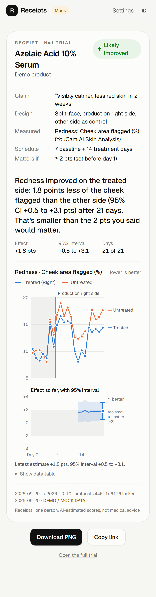
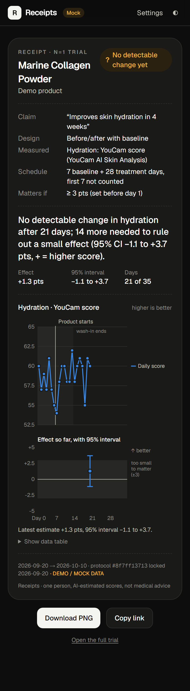
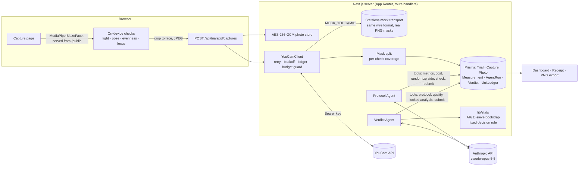

# Receipts

To configure Claude locally, open **Settings → Set Claude API key** and paste an Anthropic API key into the dialog. It is saved in the gitignored `.env.local` file on this computer; the dialog is available only in local development. On Vercel, set `ANTHROPIC_API_KEY` in the deployment environment instead. Live agent requests can incur Anthropic charges.

**Is your skincare actually working?** Receipts runs an honest *n=1 trial* of a product on your own face and gives you a statistically defensible answer instead of vibes.

An agent designs the experiment (often product on **one side of your face only**, so the other side is a built-in control), [YouCam AI Skin Analysis](https://yce.perfectcorp.com/ai-api) measures you once a day, and a pre-registered analysis produces a verdict with its uncertainty. When there isn't enough data, it says so: *"No detectable change in hydration after 21 days; 14 more needed to rule out a small effect."*

Built for the YouCam API Skin AI & eCommerce VTO Hackathon. MIT licensed.

<p align="center">
  
  
</p>

---

## How it works

1. **Add a product and its claim.** Example: "Visibly calmer, less red skin in 2 weeks."
2. **The Protocol Agent designs the trial** (Claude, tool use). It looks up what YouCam can measure and picks:
   - the design: split-face when the product is topical and confinable to one side, otherwise a baseline period then treatment;
   - the primary concern and metric that match the claim;
   - the **smallest effect size of interest (SESOI)**: the smallest change worth caring about.

   It also checks the YouCam unit cost and validates its own draft against the design rules. The treated side is **randomized server-side**, never chosen by the model.
3. **You lock it.** The protocol is frozen and hashed before day 1 (pre-registration). The metric, threshold and analysis can't be tuned after seeing data.
4. **Daily capture.** An in-browser face detector and consistency checks run *before any upload*: framing, resolution, pose, brightness, left/right lighting evenness, focus, drift from your usual brightness, and time of day. Bad photos never cost units. The photo is cropped to the face, encrypted at rest, and sent only to YouCam.
5. **YouCam AI Skin Analysis** returns concern scores and detection masks. For split-face trials Receipts measures **each cheek** from the masks.
6. **The Verdict Agent** reads the series through tools. It can run the locked analysis, but **it can't change it**. Its label must match the computed one and its wording can't overclaim, or its submission is rejected and it has to try again.
7. **Receipt.** A one-screen summary with the chart and verdict, shareable by link and exportable as PNG.

## What YouCam APIs we use and why

All calls go to `https://yce-api-01.makeupar.com` with `Authorization: Bearer <YOUCAM_API_KEY>`. Shapes are from the official OpenAPI bundle (`ai_skin_analysis.yaml`, V2.1) and were checked against the live API (free endpoints only).

| Endpoint | Why | Units |
|---|---|---|
| `POST /s2s/v2.0/file` | Register the day's (cropped, pre-checked) selfie and get a pre-signed upload URL + `file_id` | 0 |
| `PUT <pre-signed URL>` | Upload the bytes (no API key sent to S3) | 0 |
| `POST /s2s/v2.1/task/skin-analysis` | `src_file_id`, `dst_actions` (the protocol's ≤4 concerns, SD), `format: "json"`, `miniserver_args.enable_mask_overlay: false` to get one raw **mask per concern** | **9** (SD, 1-4 concerns), charged only on success |
| `GET /s2s/v2.1/task/skin-analysis/{task_id}` | Poll with backoff until `success` / `error`; read `output[]`: `ui_score`, `raw_score`, `mask_urls` | 0 |
| `GET /s2s/v1.0/client/credit` | Live unit balance on the Settings page | 0 |
| `GET /s2s/v2.0/credit/feature-cost` | Verify the price table the ledger uses | 0 |

**Why AI Skin Analysis:** it turns a phone selfie into repeatable, per-concern numbers (redness, acne, pores, texture, hydration…), which is exactly what a daily time series needs.

**Why masks matter:** YouCam's scores are whole-face. A split-face trial needs a per-side number, so Receipts downloads each concern's detection mask and measures **the share of each cheek region flagged**. The facial midline comes from the in-browser face detector. One API call per day is enough, instead of two calls on mirrored half-faces.

**Unit budget:** a 21-day trial at SD with ≤4 concerns costs **21 × 9 = 189 units**. Retakes rejected on-device, and YouCam tasks that end in `error`, cost nothing. Every task goes through a ledger (`reserved → charged / not_charged`), and live tasks are refused past `YOUCAM_UNIT_BUDGET`. Task creation is never retried on 5xx, because a duplicate task would be billed twice.

## Architecture



- **Agents** (`lib/agents/`): a manual tool-use loop on the Messages API. Adaptive thinking runs with summarized display so the reasoning is readable, effort is set explicitly, tool schemas are strict, and server-side refusal fallback is on. Every turn, tool call and result is stored in `AgentRun` and shown under "how it reasoned". Without `ANTHROPIC_API_KEY`, deterministic mock agents run the **same tools and guardrails**.
- **YouCam client** (`lib/youcam/`): typed, with injectable `fetch` / `sleep`. The mock sits at the HTTP layer, so mock mode runs the real upload, polling, retry, ledger and normalization code. Mock IDs carry their own state, so it survives serverless cold starts.
- **Stats** (`lib/stats/`): pure functions, no I/O, seeded, so verdicts don't wobble on refresh.

## The statistics (and why you can trust them)

- **Estimand.** Pre/post: mean(treatment days) − mean(baseline days). Split-face: the daily difference *treated − control* from the same photo, so shared lighting and day-to-day swings cancel, minus the same difference at baseline, which removes your face's natural asymmetry. Effects are oriented so **+ = better**. Pre-registered wash-in days are excluded from the effect.
- **Interval.** An AR(1)-sieve bootstrap (Bühlmann 1997) with a Student-t interval. Daily skin readings are autocorrelated, so treating days as independent would make intervals falsely narrow. The day-to-day carry-over φ is estimated from every logged day, with the Marriott–Pope small-sample bias correction applied per segment.
- **We tested it.** `tests/unit/stats.test.ts` simulates hundreds of trials with a known effect and AR(1) noise and checks that 95% intervals really cover the truth (≥ 90%), plus a hard case (7 + 7 days, φ = 0.45, ≥ 88%). A moving-block bootstrap only reached about 79% on this test and was replaced (see the git history).
- **Decision rule, fixed in advance.** 95% CI entirely above 0 → *improved*; entirely below → *worsened*; inside ±SESOI → *no meaningful change*; otherwise → *inconclusive*; below the minimum days → *not enough data*. One primary metric, one test. Secondary concerns are descriptive only.
- **"N more days".** A precision projection: the treatment days needed for a 95% half-width of 0.7 × SESOI, which gives 80% power to detect the SESOI. If the fixed baseline alone is too noisy to ever get there, it says so instead of inventing a number. It also reports the days left until the claim's own timeframe.
- **No retake shopping.** Only the first successful photo of each day counts.

## Setup

Requires Node 22+ (tested on 24).

```bash
npm install
npm run setup        # writes .env (imports keys from ../youcamkey.env if present), creates the SQLite DB
npm run seed:demo    # two finished 21-day demo trials (synthetic data, clearly labeled)
npm run dev          # http://localhost:3000  (/demo jumps to the split-face demo)
```

### Environment variables

| Variable | Default | Purpose |
|---|---|---|
| `DATABASE_URL` | `file:./dev.db` | SQLite locally; Postgres (Neon) URL in production |
| `YOUCAM_API_KEY` | – | YouCam API console → API Keys |
| `MOCK_YOUCAM` | `1` | `1` = never call YouCam (fixtures, 0 units). Set `0` only when you mean to spend units |
| `YOUCAM_TIER` | `sd` | `sd` (9 units, ≥480px) or `hd` (12 units, ≥1080px) |
| `YOUCAM_UNIT_BUDGET` | `600` | Hard stop for live units committed |
| `ANTHROPIC_API_KEY` | – | Enables the live Protocol / Verdict agents (otherwise deterministic mocks) |
| `ANTHROPIC_MODEL` | `claude-opus-5-5` | Agent model |
| `ANTHROPIC_EFFORT` | `medium` | `low` … `max` |
| `PHOTO_ENCRYPTION_KEY` | generated | 32 bytes, base64; encrypts selfies at rest |
| `NEXT_PUBLIC_FACE_DETECTOR` | `mediapipe` | `mock` = fixed centered face (tests only) |

The Settings page shows what's configured (masked), the unit ledger, and a free live-balance check. From the CLI, `npm run youcam:balance` does the same.

### Scripts

| Command | |
|---|---|
| `npm test` | Unit tests: stats (incl. calibration simulations), YouCam client against fixtures, agent guardrails, capture checks, crypto |
| `npm run test:e2e` | Playwright smoke test: new trial → lock → capture → analyze → verdict → receipt PNG → photo wipe, fully mocked, against a production build |
| `npm run typecheck` / `npm run lint` | |
| `npm run seed:demo` | Demo trials (`-- --live-agents` to use the real agents) |
| `node scripts/screenshots.mjs` | Full-page screenshots (light/dark, mobile/desktop) |

## Deploying (Vercel + Neon Postgres)

1. Create a Neon database through Vercel's Neon integration. It sets `DATABASE_URL` (pooled) and `DATABASE_URL_UNPOOLED`.
2. Set the env vars above in Vercel. Generate `PHOTO_ENCRYPTION_KEY` with `node -e "console.log(require('crypto').randomBytes(32).toString('base64'))"`.
3. Vercel runs `npm run vercel-build`, which swaps the Prisma provider to Postgres (`scripts/use-postgres.mjs`), pushes the schema, and builds.
4. Seed the demo once from your machine, pointing at Neon:
   ```bash
   # in .env: DATABASE_URL=<neon pooled url>  DATABASE_URL_UNPOOLED=<neon direct url>
   npm run db:postgres                                        # writes prisma/schema.postgres.prisma
   npx prisma generate --schema prisma/schema.postgres.prisma
   npx prisma db push --schema prisma/schema.postgres.prisma
   npm run seed:demo
   npx prisma generate                                        # back to the SQLite client for local dev
   ```

The schema is provider-neutral (no enums, JSON and Bytes work on both), so SQLite and Postgres stay swappable.

## Privacy

- Selfies are encrypted at rest with AES-256-GCM, each bound to its capture row. They are sent **only to YouCam**. The agents receive numbers, never photos.
- Face detection runs on-device. The MediaPipe runtime and model are served from this app, not a CDN. Fonts are self-hosted at build time.
- One click deletes every photo for a trial (scores remain). "Delete trial" removes everything. No accounts: an anonymous per-browser cookie scopes your trials. Receipts are shared by unguessable link and contain no photos.
- Not medical advice.

## Developing with YouCam's MCP server and skill

YouCam ships a remote MCP server (`https://mcp-api-01.makeupar.com/mcp/beauty`, Bearer auth, 47 tools including `AI-Skin-Analysis` and `Get-Feature-Cost`) and an official [`skin-analysis-expert`](https://github.com/YouCam-API/skills) agent skill. The workspace this repo was built in has both configured (`.mcp.json` and `.claude/skills/`, outside the repo because they hold the key). To add them yourself in Claude Code:

```bash
claude mcp add --transport http youcam-beauty https://mcp-api-01.makeupar.com/mcp/beauty --header "Authorization: Bearer $YOUCAM_API_KEY"
```

## Honest limitations

- One person, AI-estimated scores. Receipts tests the product **on you**, not in general.
- The mask format of live responses (alpha vs opaque) is handled both ways and unit-tested, but the per-cheek region geometry should be sanity-checked against a few real masks.
- Pre/post designs can't separate a treatment effect from a slow drift (season, routine changes). That's why split-face is preferred whenever possible, and why the verdict flags lighting drift between phases.

## License

[MIT](LICENSE)
